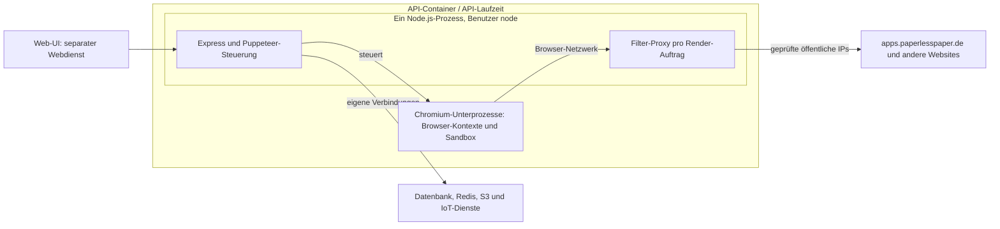

# Nachprüfung des Render-Schutzes — 27.09.2026

Nachtrag: Der anschließend ergänzte öffentliche Asset-Cache ist in
`render-security.md` dokumentiert. Seine anonymen Node-Downloads wenden die
gleiche IP-Prüfung und DNS-Pinning-Regel an. Der Cache liegt im API-Prozess;
er erweitert die Container-/Sandbox-Grenze nicht. Die folgenden offenen
OAuth-, Docker-Build- und Sandbox-Befunde werden durch den Cache nicht behoben.

## Ergebnis

Die URL-/IP-Prüfung mit DNS-Pinning, Proxy-Verwendung und isolierten
Browser-Kontexten funktioniert in den geprüften Fällen. Der Stand hat dennoch
offene Sicherheits- und Deployment-Punkte und sollte vor einem Rollout weiter
gehärtet werden. In dieser Nachprüfung wurde der Produktcode nicht verändert.

Erneut erfolgreich: 316 Tests (Unit-Tests, Slideshow-Service, Browser einschließlich
der beiden öffentlichen Smoke-Tests). Zusätzliche temporäre Browser-Proben:

- Ohne Netzwerkschutz erreichten vier UDP-Pakete, eine TURN/TCP-Verbindung und ein
  Service-Worker-HTTP-Request die lokalen Testserver. Mit Schutz: jeweils null.
- Mit ausschließlich künstlichen OAuth-Tokens wurde bestätigt, dass der ältere
  Render-Pfad diese Tokens nach einem Redirect auf eine andere Origin an die dort
  laufende Seite übergibt. Der erfolgreiche Test reproduziert einen Fehler.
- Ein Docker-Build mit künstlichen `.env`-/Token-Dateien bestätigte, dass die
  `.dockerignore` im API-Unterordner bei einem Root-Build nicht angewendet wird.

## Offene Befunde

### Hoch: OAuth-Daten im Legacy-INIT-Payload

`getRenderInitPayload()` gibt bei Nicht-Plugin-Papers das vollständige `paper`
zurück. Google-Zugangsdaten liegen in `paper.meta.googleCalendar`, einschließlich
`access_token` und `refresh_token`. Das Objekt wird per `page.evaluate()` und
`window.postMessage()` an die aktuell geladene Seite übergeben. Ein abschließender
Abgleich der Origin mit der für sensible Daten autorisierten Origin fehlt.

Ein öffentliches Ziel wird vom SSRF-Proxy bewusst zugelassen. Deshalb schützt
dieser nicht vor dem Abfluss von Zugangsdaten an die gerenderte Seite oder deren
Redirect-Ziel. Das ist ein schon vorhandener, bisher nicht behobener Fehler.

Erforderlich: expliziter Render-Datentransfer mit ausschließlich benötigten
Anzeige-Feldern; OAuth-Tokens bleiben serverseitig. Zusätzlich braucht die Übergabe
sensibler Nutzdaten eine definierte Origin-Vertrauensregel. Nur `"*"` durch eine
Origin zu ersetzen entfernt die Tokens nicht aus dem Payload.

### Hoch: fehlende Ignore-Regeln beim Root-Docker-Build

Die API-README empfiehlt Dokploy mit Repository-Root als Build-Kontext und
`Dockerfile.paperlesspaper-api`. Dieser kopiert den API-Ordner vollständig nach
`/app`. Im Root fehlen sowohl `.dockerignore` als auch eine
`Dockerfile.paperlesspaper-api.dockerignore`. Die vorhandene
`packages/paperlesspaper-api/.dockerignore` gilt nur, wenn dieser Unterordner
selbst der Build-Kontext ist.

Sind `.env`, Token-Dateien, Registry-Konfiguration oder lokale `node_modules` im
Build-Kontext vorhanden, können sie dadurch ins Image gelangen. Lokale `.env`-
und Token-Dateien existieren; ihre Inhalte wurden nicht gelesen oder in einen
Build übertragen. Bei einem sauberen Git-Checkout hängt die Exposition davon ab,
welche Dateien tatsächlich im Build-Kontext vorhanden sind. Ein bereits erfolgtes
Produktionsleck wurde nicht festgestellt.

Erforderlich: Dockerfile-spezifische Ignore-Regeln für den Root-Build, mit einer
kleinen Liste zugelassener Build-Eingaben und expliziten Secret-Ausschlüssen.

### Hoch: Sandbox-Voraussetzung vor dem Deployment klären

Die Entfernung von `--no-sandbox` und der Wechsel zu `USER node` sind sinnvoll.
Im vorherigen Linux-Test scheiterte aber ein Standard-Docker-Start an fehlenden
Namespace-Rechten. Der isolierte Renderer-Test mit `--cap-add=SYS_ADMIN` war
erfolgreich. Eine passende Produktions-Runtime-Konfiguration wurde nicht gesetzt.

Die tatsächliche Dokploy/Docker-Umgebung muss vor dem Rollout überprüft werden.
Die zusätzlich vorhandene Fly-Konfiguration beweist nicht, dass Fly derzeit der
Produktionshost ist. Der vorherige nicht erfolgreiche Fly-Zugriff validiert
Dokploy nicht. Breite Container-Rechte sollten besonders für einen gemeinsamen
API-/Browser-Container nicht ungeprüft übernommen werden.

## Platzierung und Grenzen

Aus den Build-Dateien ergibt sich folgende logische Struktur. Tatsächliche
Produktions-Container-Namen und aktuelle Host-Einstellungen wurden nicht geprüft.

- Beide API-Dockerfiles sind alternative Build-Wege für dieselbe API. Ihre
  Build-/Runtime-Stages erzeugen keine Trennung zwischen laufender API und Browser.
- API-Code, Abhängigkeiten und Token-Cache liegen unter `/app`. Chromium liegt
  unter `/usr/bin/chromium-headless-shell`. Beides gehört zum API-Runtime-Image.
- Der Proxy ist ein HTTP-Server im bestehenden API-Node-Prozess. Er bindet nur an
  `127.0.0.1` und einen dynamischen Port; er ist kein weiterer Container.
- Chromium startet als Kindprozess der API. Alle Aufträge teilen eine
  Browser-Instanz. Pro Auftrag werden ein neuer Browser-Kontext und Proxy angelegt
  und danach geschlossen. Ein Kontext trennt Sitzungsdaten, ist aber keine eigene
  VM, kein Container und keine eigenständige CPU-/RAM-Grenze.
- Der Web-Dockerfile enthält die gebaute UI und `server.mjs`, keinen Renderer.
  Das separate `paperlesspaper-apps`-Projekt enthält die Next.js-Seiten; dessen
  Deploy-Skript verwendet Vercel. Die tatsächliche Live-Hosting-Zuordnung wurde
  nicht überprüft.

Die Schutzgrenzen sind unterschiedlich:

1. **Proxy:** kontrolliert Browser-Zieladressen einschließlich Redirects und
   DNS-Auflösung. Eigene `fetch`-/Axios-/SDK-Verbindungen des API-Prozesses und
   serverseitige Requests des Apps-Dienstes werden davon nicht gefiltert.
2. **Browser-Kontext:** trennt Cookies, Storage und Lebensdauer der Aufträge.
3. **Chromium-Sandbox:** schränkt die Prozesse ein, die fremden Seiten-Code
   ausführen. Sie ersetzt keine vollständige Trennung von API und Browser.
4. **Container/Laufzeit:** ist derzeit eine gemeinsame Grenze für API und Browser.
   Es gibt keine zusätzliche OS-Netzwerksperre zwischen beiden.

Zusätzliche Einschränkungen: Chromium erbt derzeit standardmäßig die API-
Umgebungsvariablen. API und Browser verwenden denselben OS-Benutzer, und `/app`
ist durch die neuen Eigentümerrechte vollständig schreibbar. Normales Seiten-JS
erhält dadurch keinen direkten Zugriff auf diese Dateien oder Variablen. Bei
einer Browser-/Sandbox-Kompromittierung fehlt jedoch eine weitere Grenze zu den
API-Rechten. CPU/RAM und die gemeinsame Browser-Instanz werden ebenfalls geteilt;
vorhandene Navigations-/Netzwerk-Timeouts ersetzen keine Ressourcenlimits und
keinen hart durchgesetzten Gesamt-Abbruch pro Auftrag.

## Änderungen des bisherigen Patches

- `renderNetwork.ts`: HTTP(S)-/IP-Regeln, DNS-Pinning, Filter-Proxy,
  explizite Entwicklungs-Ausnahmen und sichere App-URL-Umschreibung.
- `render.service.ts`: eigener Kontext und Proxy pro Auftrag, Sandbox aktiviert,
  QUIC deaktiviert, WebRTC-UDP eingeschränkt, Downloads gesperrt,
  vollständigen Paper-Debug-Log entfernt.
- Beide API-Dockerfiles: Ausführung als `node`, Eigentümerrechte für `/app`.
- Tests und Dokumentation: Browser-Bildvergleich, Regressionen und
  Sicherheitsproben. Keine separate Renderer-Infrastruktur und kein Deployment.

Priorität: zuerst Render-Payload bereinigen, Root-Build absichern und die
Dokploy-Sandbox-Konfiguration verifizieren. Für eine stärkere dauerhafte Grenze:
separater Render-Worker ohne API-Secrets, mit begrenztem Dateisystem,
CPU/RAM-Limits und per Betriebssystem erzwungenem ausgehendem Netzwerkzugriff.
